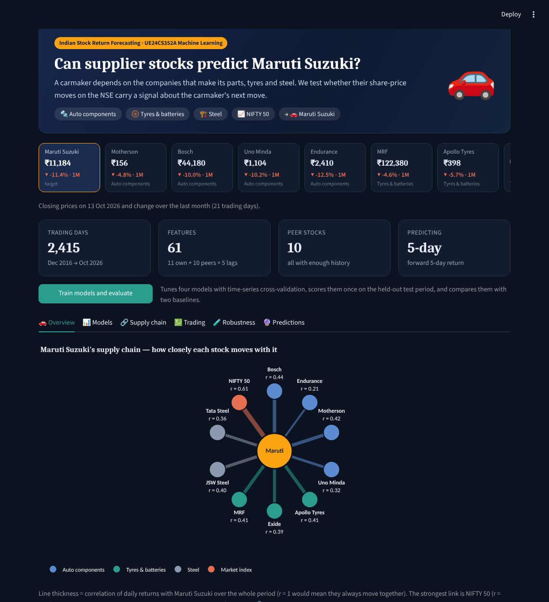

# Indian Stock Return Forecasting with Machine Learning

An ML mini-project (UE24CS352A) that adapts the method of the Stanford CS229 report *"Quantitative Trading with Machine Learning"* (R. M. Glawion, 2021) to Indian stocks. The paper predicts Volkswagen's returns from the past returns of its suppliers' stocks. We do the same for an Indian automaker, **Maruti Suzuki (`MARUTI.NS`)**, using its listed suppliers and the NIFTY 50 index, and we add the stock's own price/volume features, which the paper listed as future work.

> Educational project only. Historical backtests are not evidence of future profitability and are not financial advice.



## What it does
- Downloads daily data for a target stock and optional supplier/peer stocks via `yfinance` (or reads saved CSVs).
- Builds 11 own price/volume features plus lagged daily returns of each peer (default 5 lags; the paper used 28).
- Predicts the forward **h-day return** (h = 1, 5 or 20), or optionally the **excess return over the NIFTY 50**, with **Elastic Net, Decision Tree, Random Forest and Gradient Boosting**.
- Compares every model with two baselines: **predict 0** (the paper's footnote 3) and **historical mean**, and tests whether any difference is **statistically significant** (Diebold–Mariano test).
- **Tunes and selects models with time-series cross-validation** (4 expanding folds), then scores each model once on an untouched test set.
- Checks whether the supplier/peer features help (**ablation**: the same model with and without them).
- Runs a **long/flat trading backtest** with transaction costs, and reports return, volatility, Sharpe ratio, max drawdown and number of trades. Includes a **threshold sensitivity table**, like the paper's Table 2.
- **Robustness checks**: walk-forward evaluation over 5 periods, and a horizon comparison table like the paper's Table 1.
- A Streamlit dashboard: a market strip of Maruti and its suppliers, a supply-chain map, a lead-lag heatmap (do supplier moves come first?), headline findings, and Overview · Models · Supply chain · Trading · Robustness · Predictions tabs with interactive Plotly charts, a command-line script that saves every result table for the write-up, and automated tests.

## Quick start (Windows)
```powershell
py -m venv .venv
.venv\Scripts\Activate.ps1
python -m pip install --upgrade pip
pip install -r requirements.txt
streamlit run app.py
```
If PowerShell blocks activation, use Command Prompt: `.venv\Scripts\activate.bat`

macOS/Linux: `python3 -m venv .venv && source .venv/bin/activate`, then the same `pip` and `streamlit` commands.

## Reproduce the results for the write-up
```bash
python run_experiment.py --ticker MARUTI.NS              # with suppliers + NIFTY 50
python run_experiment.py --ticker MARUTI.NS --no-peers   # own features only, for comparison
python run_experiment.py --ticker MARUTI.NS --target excess   # predict return vs NIFTY 50
```
Everything is saved to `reports/results/<ticker>/`. That includes `summary.md` (all tables, ready to copy), CSVs of every table, `equity_curve.png`, and the downloaded data (`data_target.csv`, `data_peers.csv`), which you can reuse offline:
```bash
python run_experiment.py --csv reports/results/MARUTI.NS/data_target.csv --peers-csv reports/results/MARUTI.NS/data_peers.csv
```
Other options: `--horizon 1|5|20`, `--target raw|excess`, `--cv-folds 4` (0 = single validation period), `--peer-lags 28`, `--threshold 0.25`, `--cost 0.05`, `--no-tune`, `--peers T1 T2 ...`, `--name FOLDER`.

## Run the tests
```bash
python -m pytest -q
```
The tests check that features never use future prices, that the target equals the forward return, that the split is time-ordered with an embargo, that late-listed peers are dropped, that the predict-0 baseline is computed correctly, that the backtest signal is lagged and pays costs, that the significance test detects a real difference, that cross-validation folds are time-ordered with an embargo, and that the excess-return target is computed correctly (15 tests).

## Data
| Role | Tickers (Yahoo Finance) |
|---|---|
| Target | `MARUTI.NS` (Maruti Suzuki) |
| Auto components | `MOTHERSON.NS`, `BOSCHLTD.NS`, `UNOMINDA.NS`, `ENDURANCE.NS` |
| Tyres / batteries | `MRF.NS`, `APOLLOTYRE.NS`, `EXIDEIND.NS` |
| Steel | `TATASTEEL.NS`, `JSWSTEEL.NS` |
| Market | `^NSEI` (NIFTY 50) |

These are publicly listed companies in Maruti's broad supplier base (components, tyres, batteries, steel). The list is our own selection, not a verified supply-contract dataset. Any ticker can be entered in the app or passed with `--peers`.

**Missing data.** A peer that covers less than 90% of the target's trading days (e.g. a late listing) is dropped and reported. Short gaps caused by different holidays are forward-filled for at most 5 days, using past prices only. Rows that still have missing values are removed. We never fill with 0, which is what the paper did.

**Offline demo.** `data/synthetic_demo.csv` and `data/synthetic_peers_demo.csv` are **simulated** data, made by `scripts/make_synthetic_peers.py`. They exist only so the app works without internet. They are not market data and must not be reported as results.

**CSV format.** For the target: `Date, Open, High, Low, Close, Volume` (`Datetime` is also accepted). For peers: `Date`, then one closing-price column per ticker.

## Methodology
1. **Features (at day t, using data up to day t only).**
   - Own features: 1-, 5- and 20-day returns; price vs 5/20/50-day moving average; 10- and 20-day volatility; volume change; intraday range; close location within the day's range.
   - Peer features: each peer's daily return on days t, t−1, …, t−(L−1).
2. **Target.** `Close[t+h] / Close[t] − 1`. With `--target excess`, the NIFTY 50's return over the same h days is subtracted, so the model predicts whether Maruti will beat or lag the market. This removes market-wide moves, which are noise for a supplier-based signal.
3. **Split.** Chronological 60% train / 20% validation / 20% test. The last h rows before each boundary are dropped (an embargo), so no training target overlaps a later block.
4. **Models, tuning and selection.** Each model is tuned over a small grid using **time-series cross-validation**. Train+validation is split into 4 expanding folds: each fold's block is predicted by a model trained on every earlier row, with a 5-row embargo. A setting's score is its average RMSE over the 4 folds, so the choice does not depend on one possibly lucky validation period.
   - Elastic Net: `alpha` ∈ {1e-4, 1e-3, 1e-2}, `l1_ratio` ∈ {0.1, 0.5, 1}. The `l1_ratio` grid mirrors the paper's α ∈ {0, .5, 1}. scikit-learn's `alpha` is the overall penalty strength; the paper's α is the L1/L2 mix, which scikit-learn calls `l1_ratio`.
   - Decision Tree: `max_depth` ∈ {3, 5, 8}, `min_samples_leaf` ∈ {10, 30}.
   - Random Forest (150 trees): `max_depth` ∈ {4, 8}, `min_samples_leaf` ∈ {5, 20}.
   - Gradient Boosting (scikit-learn's `HistGradientBoostingRegressor`, similar to LightGBM): `learning_rate` ∈ {0.05, 0.1}, `max_depth` ∈ {2, 3}.
   - The model with the lowest cross-validated RMSE is selected. Every model is then refit on train+validation and scored **once** on test.
5. **Metrics.** RMSE, MAE, direction accuracy, and **skill vs predict-0** = 1 − SSE(model) / SSE(predict 0). A positive value means the model beats always guessing "no change".
6. **Significance.** A **Diebold–Mariano test** compares each model's squared errors with predict-0's on the test set. Overlapping h-day targets make errors autocorrelated, so the variance includes autocovariances up to lag h−1, with the Harvey–Leybourne–Newbold small-sample correction. p < 0.05 means the difference is unlikely to be chance.
7. **Ablation.** Every model is retrained with own features only (same settings), to measure what the peers add.
8. **Backtest.** Long/flat. Hold the stock on day t only if the forecast made at the close of day t−1 is above the threshold; otherwise hold cash. Each buy or sell costs the chosen percentage (default 0.05%). Positions are held one day at a time, so overlapping h-day forecasts are not double-counted. Results are compared with buy-and-hold over the same days.
9. **Walk-forward.** The second half of the history is cut into 5 consecutive test periods. For each one, models are trained on all earlier data (minus the embargo) with default settings. This is closer to the paper's 109-step rolling window.

**Limitations.** Fixed small grids; no slippage, taxes or liquidity limits; the supplier list is hand-picked; correlation is not causation; and markets change over time.

## Differences from the Stanford paper
| | Paper | This project |
|---|---|---|
| Target | Volkswagen (Frankfurt) | Maruti Suzuki (NSE), or any ticker |
| Features | 30 suppliers × 28 lags + macro | ~10 peers × L lags + 11 own price/volume features |
| Models | Elastic Net, Decision Tree, XGBoost, LightGBM | Elastic Net, Decision Tree, Random Forest, Gradient Boosting |
| Baseline | Footnote only | Predict-0 and historical-mean rows in every table |
| Missing values | Filled with 0 | Late listings dropped; short gaps forward-filled |
| Evaluation | Rolling, 109 refits | Time-series CV for selection, one held-out test period, 5-period walk-forward |
| Significance | None | Diebold–Mariano test vs predict-0 |
| Strategy | Long/short, no costs | Long/flat, with costs |
| Risk | Not reported | Volatility, Sharpe ratio, max drawdown, trades |

## Results (MARUTI.NS, 5-day horizon)
Data: Yahoo Finance, 2,415 trading days after feature engineering (Dec 2016 → Oct 2026). Features: 11 own + 10 peers × 5 lags = 61.
Split: train Dec 2016 → Oct 2022 (1,444 rows), validation Nov 2022 → Oct 2024 (478), test Oct 2024 → Oct 2026 (483). Models selected with 4-fold time-series cross-validation inside train+validation.

**Forecast accuracy on the test set** (lower RMSE is better; same settings with and without suppliers):
| Model | RMSE own features (%) | RMSE own + suppliers (%) | Diebold–Mariano p vs predict-0 |
|---|---|---|---|
| Baseline: predict 0 | 3.375 | 3.375 | — |
| Random Forest | 3.401 | 3.388 | 0.76 |
| Gradient Boosting | 3.420 | 3.385 | 0.88 |
| Elastic Net (selected) | 3.387 | 3.387 | 0.73 |
| Decision Tree | 3.470 | 3.470 | 0.30 |

**Main findings**
- **No model beats guessing "no change", and no difference is statistically significant** (all Diebold–Mariano p-values ≥ 0.30). Cross-validation selected Elastic Net with a strong penalty, which shrinks every coefficient to zero: the most reliable forecast it found is the historical average. In the 5-period walk-forward, the historical-mean baseline also had the lowest average error. This matches the reference paper's footnote that predicting zero is almost as accurate.
- **Supplier features help the tree ensembles slightly** (Random Forest −0.013 pts RMSE, Gradient Boosting −0.036), but not enough to beat predict-0.
- **Longer horizons look better but are not significant.** At 20 days, Gradient Boosting (7.31%) and Random Forest (7.36%) with suppliers have lower RMSE than predict-0 (7.54%), yet p ≈ 0.6. Two years of overlapping 20-day returns contain only about 24 independent periods, which is too few to confirm a small edge.
- **Excess-return target** (Maruti minus NIFTY 50): removing market moves cuts the error from 3.38% to 2.77%, but every model again matches or trails predict-0 (p ≥ 0.13). See [`MARUTI.NS_excess/summary.md`](reports/results/MARUTI.NS_excess/summary.md).
- **Error grows with the horizon** (predict-0 RMSE: 1.44% at 1 day, 3.38% at 5 days, 7.54% at 20 days), as in the paper.
- **Strategy:** the selected model's forecasts barely vary, so at a 0.25% threshold it stays invested and returns −3.35% vs −3.30% for buy-and-hold.

**What changed from the version presented on 15 Oct 2026.** That version chose models on a single validation period and had no significance test:

| | Single validation period (presented) | Time-series CV + significance test (now) |
|---|---|---|
| Selected model | Decision Tree (won validation by 0.004 pts) | Elastic Net |
| Random Forest test RMSE | 3.356% (below predict-0's 3.375%) | 3.388% (above it) |
| Is Random Forest's edge significant? | Not tested (p = 0.71 when tested afterwards) | No |
| Strategy return | +6.7% vs −3.3% buy-and-hold | −3.35% vs −3.30% |

The earlier "Random Forest beats predict-0" result and the +6.7% strategy return came from a hyperparameter choice that happened to suit one validation period. Neither survives robust model selection or a significance test, which is exactly the overfitting-to-the-validation-set risk the upgrade was meant to catch. The write-up and slides in `reports/` are the versions presented on 15 Oct.

Full tables: [`MARUTI.NS/summary.md`](reports/results/MARUTI.NS/summary.md) · own features only: [`MARUTI.NS_own_only/summary.md`](reports/results/MARUTI.NS_own_only/summary.md) · excess return: [`MARUTI.NS_excess/summary.md`](reports/results/MARUTI.NS_excess/summary.md)

## Project structure
```text
app.py                         Streamlit dashboard (live demo)
.streamlit/config.toml         dashboard dark theme
docs/dashboard.png             screenshot used in this README
trading_ml.py                  data, features, models, evaluation, backtest
run_experiment.py              command-line run that saves all tables/charts
tests/test_pipeline.py         leakage and correctness tests
scripts/make_synthetic_peers.py  generator for the simulated peer demo data
data/                          simulated demo CSVs (not market data)
reports/                       write-up and presentation outline; results/ is created by run_experiment.py
```

## Team contributions
- **Nyssa:** data pipeline and supplier selection, feature engineering, backtest and risk metrics, Streamlit dashboard, write-up and presentation
- **Yathindra:** model training and hyperparameter tuning, evaluation (baselines, ablation, walk-forward, horizons), tests, running the experiments and analysing the results

## Submission checklist
- [ ] Private GitHub repository, shared with faculty/TAs
- [x] Ran `run_experiment.py` on real data and pasted the numbers into the write-up and slides
- [x] Write-up exported as PDF (`reports/two_page_writeup.pdf`)
- [x] Saved data CSVs as a backup in case Yahoo fails during the demo (`reports/results/MARUTI.NS/data_*.csv`)
- [x] Team contributions filled in above
