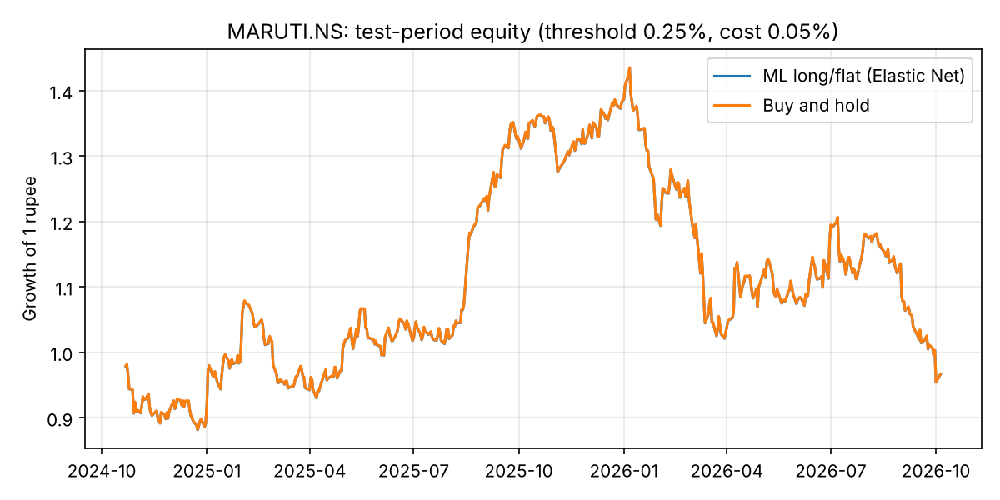

# Results: MARUTI.NS

- Source: Yahoo Finance via yfinance, period=10y (saved download: `reports/results/MARUTI.NS/data_target.csv`, `data_peers.csv`)
- Rows used: 2415 (from 2471); 2016-12-23 → 2026-10-05
- Target: forward 5-day return; features: 61
- Peers used: MOTHERSON.NS, BOSCHLTD.NS, UNOMINDA.NS, ENDURANCE.NS, MRF.NS, APOLLOTYRE.NS, EXIDEIND.NS, TATASTEEL.NS, JSWSTEEL.NS, ^NSEI
- Split: train 2016-12-23 → 2022-10-25; validation 2022-11-03 → 2024-10-11; test 2024-10-21 → 2026-10-05
- Model selection: time-series cross-validation (4 folds inside train+validation)
- Selected model: **Elastic Net** ({'alpha': 0.01, 'l1_ratio': 0.5})
- Test RMSE 3.387% vs predict-0 baseline 3.375% → does NOT beat baseline; Diebold–Mariano p = 0.728

## Test metrics
| Model                     |   RMSE (%) |   MAE (%) | Direction accuracy (%)   |   Skill vs predict-0 (%) | DM p-value vs predict-0   |   Selection RMSE (%) |
|:--------------------------|-----------:|----------:|:-------------------------|-------------------------:|:--------------------------|---------------------:|
| Baseline: predict 0       |      3.375 |     2.493 | —                        |                    0     | —                         |                3.415 |
| Gradient Boosting         |      3.385 |     2.517 | 51.967                   |                   -0.562 | 0.88                      |                3.48  |
| Baseline: historical mean |      3.387 |     2.518 | 48.654                   |                   -0.71  | 0.728                     |                3.394 |
| Elastic Net               |      3.387 |     2.518 | 48.654                   |                   -0.71  | 0.728                     |                3.394 |
| Random Forest             |      3.388 |     2.528 | 49.275                   |                   -0.768 | 0.763                     |                3.406 |
| Decision Tree             |      3.47  |     2.578 | 51.553                   |                   -5.723 | 0.304                     |                3.489 |

## Do peers help? (each model, with vs without)
| Model             |   RMSE own only (%) |   RMSE own + peers (%) |   Change (%) | Peers help?   | Beats predict-0 with peers?   |
|:------------------|--------------------:|-----------------------:|-------------:|:--------------|:------------------------------|
| Elastic Net       |               3.387 |                  3.387 |        0     | no            | no                            |
| Decision Tree     |               3.47  |                  3.47  |        0     | no            | no                            |
| Random Forest     |               3.401 |                  3.388 |       -0.013 | yes           | no                            |
| Gradient Boosting |               3.42  |                  3.385 |       -0.036 | yes           | no                            |

## Importance by source
| Source           |   Importance |   Share (%) |
|:-----------------|-------------:|------------:|
| APOLLOTYRE.NS    |            0 |           0 |
| BOSCHLTD.NS      |            0 |           0 |
| ENDURANCE.NS     |            0 |           0 |
| EXIDEIND.NS      |            0 |           0 |
| JSWSTEEL.NS      |            0 |           0 |
| MOTHERSON.NS     |            0 |           0 |
| MRF.NS           |            0 |           0 |
| Own price/volume |            0 |           0 |
| TATASTEEL.NS     |            0 |           0 |
| UNOMINDA.NS      |            0 |           0 |
| ^NSEI            |            0 |           0 |

## Strategy (threshold 0.25%, cost 0.05%)
| Strategy                   |   Total return (%) |   Annual return (%) |   Annual volatility (%) |   Sharpe ratio |   Max drawdown (%) |   Trades |   Time in market (%) |
|:---------------------------|-------------------:|--------------------:|------------------------:|---------------:|-------------------:|---------:|---------------------:|
| ML long/flat (Elastic Net) |             -3.351 |              -1.766 |                  22.84  |          0.035 |            -33.493 |        1 |                  100 |
| Buy and hold               |             -3.302 |              -1.74  |                  22.838 |          0.037 |            -33.493 |        1 |                  100 |

## Threshold sensitivity
| Rule                        |   Total return (%) | Sharpe ratio   |   Max drawdown (%) |   Trades |   Time in market (%) |
|:----------------------------|-------------------:|:---------------|-------------------:|---------:|---------------------:|
| ML, buy if forecast > 0%    |             -3.351 | 0.035          |            -33.493 |        1 |                  100 |
| ML, buy if forecast > 0.25% |             -3.351 | 0.035          |            -33.493 |        1 |                  100 |
| ML, buy if forecast > 0.5%  |              0     | —              |              0     |        0 |                    0 |
| ML, buy if forecast > 1%    |              0     | —              |              0     |        0 |                    0 |
| Buy and hold                |             -3.302 | 0.037          |            -33.493 |        1 |                  100 |

## Walk-forward (5 periods)
| Model                     |   Mean RMSE (%) |   Worst fold RMSE (%) | Mean direction acc. (%)   | Folds beating predict-0   |
|:--------------------------|----------------:|----------------------:|:--------------------------|:--------------------------|
| Baseline: historical mean |           3.335 |                 4.483 | 51.081                    | 4 / 5                     |
| Baseline: predict 0       |           3.34  |                 4.502 | —                         | —                         |
| Random Forest             |           3.376 |                 4.669 | 51.323                    | 2 / 5                     |
| Elastic Net               |           3.393 |                 4.411 | 49.595                    | 1 / 5                     |
| Gradient Boosting         |           3.429 |                 4.708 | 52.153                    | 2 / 5                     |
| Decision Tree             |           3.63  |                 5.64  | 50.829                    | 0 / 5                     |

## Test RMSE (%) by horizon
| Model                     |   h=1 |   h=5 |   h=20 |
|:--------------------------|------:|------:|-------:|
| Baseline: predict 0       | 1.44  | 3.375 |  7.544 |
| Elastic Net               | 1.441 | 3.387 |  7.594 |
| Baseline: historical mean | 1.441 | 3.387 |  7.594 |
| Random Forest             | 1.443 | 3.388 |  7.359 |
| Gradient Boosting         | 1.485 | 3.385 |  7.314 |
| Decision Tree             | 1.496 | 3.47  |  7.433 |

