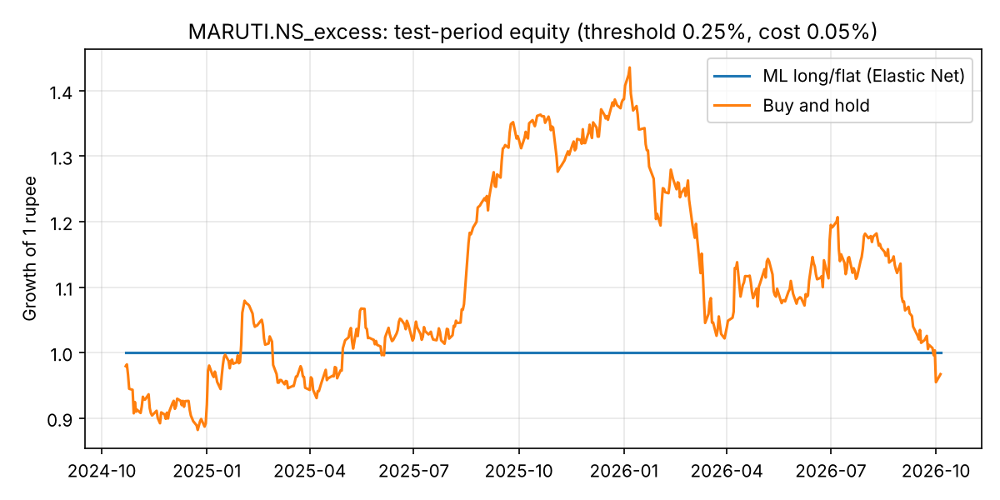

# Results: MARUTI.NS_excess

- Source: Yahoo Finance via yfinance, period=10y (saved download: `reports/results/MARUTI.NS/data_target.csv`, `data_peers.csv`)
- Rows used: 2415 (from 2471); 2016-12-23 → 2026-10-05
- Target: forward 5-day return minus NIFTY 50's (excess); features: 61
- Peers used: MOTHERSON.NS, BOSCHLTD.NS, UNOMINDA.NS, ENDURANCE.NS, MRF.NS, APOLLOTYRE.NS, EXIDEIND.NS, TATASTEEL.NS, JSWSTEEL.NS, ^NSEI
- Split: train 2016-12-23 → 2022-10-25; validation 2022-11-03 → 2024-10-11; test 2024-10-21 → 2026-10-05
- Model selection: time-series cross-validation (4 folds inside train+validation)
- Selected model: **Elastic Net** ({'alpha': 0.01, 'l1_ratio': 0.5})
- Test RMSE 2.765% vs predict-0 baseline 2.765% → beats baseline; Diebold–Mariano p = 0.723

## Test metrics
| Model                     |   RMSE (%) |   MAE (%) | Direction accuracy (%)   |   Skill vs predict-0 (%) | DM p-value vs predict-0   |   Selection RMSE (%) |
|:--------------------------|-----------:|----------:|:-------------------------|-------------------------:|:--------------------------|---------------------:|
| Elastic Net               |      2.765 |     2.029 | 50.932                   |                    0.01  | 0.723                     |                3.043 |
| Baseline: historical mean |      2.765 |     2.029 | 50.932                   |                    0.01  | 0.723                     |                3.043 |
| Baseline: predict 0       |      2.765 |     2.029 | —                        |                    0     | —                         |                3.039 |
| Decision Tree             |      2.779 |     2.041 | 49.689                   |                   -1.018 | 0.307                     |                3.119 |
| Random Forest             |      2.816 |     2.066 | 48.033                   |                   -3.712 | 0.212                     |                3.067 |
| Gradient Boosting         |      2.861 |     2.093 | 48.861                   |                   -7.11  | 0.129                     |                3.116 |

## Do peers help? (each model, with vs without)
| Model             |   RMSE own only (%) |   RMSE own + peers (%) |   Change (%) | Peers help?   | Beats predict-0 with peers?   |
|:------------------|--------------------:|-----------------------:|-------------:|:--------------|:------------------------------|
| Elastic Net       |               2.765 |                  2.765 |        0     | no            | yes                           |
| Decision Tree     |               2.768 |                  2.779 |        0.011 | no            | no                            |
| Random Forest     |               2.804 |                  2.816 |        0.012 | no            | no                            |
| Gradient Boosting |               2.858 |                  2.861 |        0.003 | no            | no                            |

## Importance by source
| Source           |   Importance |   Share (%) |
|:-----------------|-------------:|------------:|
| APOLLOTYRE.NS    |            0 |           0 |
| BOSCHLTD.NS      |            0 |           0 |
| ENDURANCE.NS     |            0 |           0 |
| EXIDEIND.NS      |            0 |           0 |
| JSWSTEEL.NS      |            0 |           0 |
| MOTHERSON.NS     |            0 |           0 |
| MRF.NS           |            0 |           0 |
| Own price/volume |            0 |           0 |
| TATASTEEL.NS     |            0 |           0 |
| UNOMINDA.NS      |            0 |           0 |
| ^NSEI            |            0 |           0 |

## Strategy (threshold 0.25%, cost 0.05%)
| Strategy                   |   Total return (%) |   Annual return (%) |   Annual volatility (%) | Sharpe ratio   |   Max drawdown (%) |   Trades |   Time in market (%) |
|:---------------------------|-------------------:|--------------------:|------------------------:|:---------------|-------------------:|---------:|---------------------:|
| ML long/flat (Elastic Net) |              0     |                0    |                   0     | —              |              0     |        0 |                    0 |
| Buy and hold               |             -3.302 |               -1.74 |                  22.838 | 0.037          |            -33.493 |        1 |                  100 |

## Threshold sensitivity
| Rule                        |   Total return (%) | Sharpe ratio   |   Max drawdown (%) |   Trades |   Time in market (%) |
|:----------------------------|-------------------:|:---------------|-------------------:|---------:|---------------------:|
| ML, buy if forecast > 0%    |             -3.351 | 0.035          |            -33.493 |        1 |                  100 |
| ML, buy if forecast > 0.25% |              0     | —              |              0     |        0 |                    0 |
| ML, buy if forecast > 0.5%  |              0     | —              |              0     |        0 |                    0 |
| ML, buy if forecast > 1%    |              0     | —              |              0     |        0 |                    0 |
| Buy and hold                |             -3.302 | 0.037          |            -33.493 |        1 |                  100 |

## Walk-forward (5 periods)
| Model                     |   Mean RMSE (%) |   Worst fold RMSE (%) | Mean direction acc. (%)   | Folds beating predict-0   |
|:--------------------------|----------------:|----------------------:|:--------------------------|:--------------------------|
| Baseline: predict 0       |           2.846 |                 3.901 | —                         | —                         |
| Baseline: historical mean |           2.852 |                 3.913 | 47.342                    | 2 / 5                     |
| Elastic Net               |           2.902 |                 3.953 | 48.76                     | 0 / 5                     |
| Random Forest             |           2.903 |                 4.031 | 50.74                     | 1 / 5                     |
| Gradient Boosting         |           2.943 |                 4.093 | 50.08                     | 1 / 5                     |
| Decision Tree             |           3.014 |                 4.233 | 45.525                    | 0 / 5                     |

## Test RMSE (%) by horizon
| Model                     |   h=1 |   h=5 |   h=20 |
|:--------------------------|------:|------:|-------:|
| Baseline: predict 0       | 1.196 | 2.765 |  6.318 |
| Elastic Net               | 1.196 | 2.765 |  6.205 |
| Baseline: historical mean | 1.196 | 2.765 |  6.327 |
| Random Forest             | 1.208 | 2.816 |  6.213 |
| Decision Tree             | 1.23  | 2.779 |  6.201 |
| Gradient Boosting         | 1.24  | 2.861 |  6.229 |

