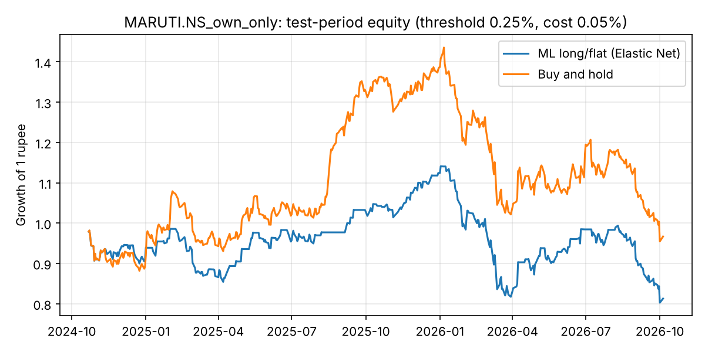

# Results: MARUTI.NS_own_only

- Source: Yahoo Finance via yfinance, period=10y (saved download: `reports/results/MARUTI.NS/data_target.csv`, `data_peers.csv`)
- Rows used: 2415 (from 2471); 2016-12-23 → 2026-10-05
- Target: forward 5-day return; features: 11
- Peers used: none
- Split: train 2016-12-23 → 2022-10-25; validation 2022-11-03 → 2024-10-11; test 2024-10-21 → 2026-10-05
- Model selection: time-series cross-validation (4 folds inside train+validation)
- Selected model: **Elastic Net** ({'alpha': 0.01, 'l1_ratio': 0.1})
- Test RMSE 3.437% vs predict-0 baseline 3.375% → does NOT beat baseline; Diebold–Mariano p = 0.203

## Test metrics
| Model                     |   RMSE (%) |   MAE (%) | Direction accuracy (%)   |   Skill vs predict-0 (%) | DM p-value vs predict-0   |   Selection RMSE (%) |
|:--------------------------|-----------:|----------:|:-------------------------|-------------------------:|:--------------------------|---------------------:|
| Baseline: predict 0       |      3.375 |     2.493 | —                        |                    0     | —                         |                3.415 |
| Baseline: historical mean |      3.387 |     2.518 | 48.654                   |                   -0.71  | 0.728                     |                3.394 |
| Random Forest             |      3.401 |     2.551 | 49.689                   |                   -1.553 | 0.637                     |                3.428 |
| Gradient Boosting         |      3.42  |     2.568 | 54.244                   |                   -2.705 | 0.538                     |                3.551 |
| Elastic Net               |      3.437 |     2.553 | 49.896                   |                   -3.676 | 0.203                     |                3.389 |
| Decision Tree             |      3.47  |     2.578 | 51.553                   |                   -5.723 | 0.304                     |                3.475 |

## Importance by source
| Source           |   Importance |   Share (%) |
|:-----------------|-------------:|------------:|
| Own price/volume |        0.006 |         100 |

## Strategy (threshold 0.25%, cost 0.05%)
| Strategy                   |   Total return (%) |   Annual return (%) |   Annual volatility (%) |   Sharpe ratio |   Max drawdown (%) |   Trades |   Time in market (%) |
|:---------------------------|-------------------:|--------------------:|------------------------:|---------------:|-------------------:|---------:|---------------------:|
| ML long/flat (Elastic Net) |            -18.693 |             -10.254 |                  18.057 |         -0.509 |            -29.654 |       89 |                68.88 |
| Buy and hold               |             -3.302 |              -1.74  |                  22.838 |          0.037 |            -33.493 |        1 |               100    |

## Threshold sensitivity
| Rule                        |   Total return (%) |   Sharpe ratio |   Max drawdown (%) |   Trades |   Time in market (%) |
|:----------------------------|-------------------:|---------------:|-------------------:|---------:|---------------------:|
| ML, buy if forecast > 0%    |            -15.491 |         -0.301 |            -29.82  |       39 |               90.456 |
| ML, buy if forecast > 0.25% |            -18.693 |         -0.509 |            -29.654 |       89 |               68.88  |
| ML, buy if forecast > 0.5%  |            -28.07  |         -1.265 |            -27.639 |       69 |               27.386 |
| ML, buy if forecast > 1%    |              0.452 |          0.09  |             -3.326 |        4 |                0.622 |
| Buy and hold                |             -3.302 |          0.037 |            -33.493 |        1 |              100     |

## Walk-forward (5 periods)
| Model                     |   Mean RMSE (%) |   Worst fold RMSE (%) | Mean direction acc. (%)   | Folds beating predict-0   |
|:--------------------------|----------------:|----------------------:|:--------------------------|:--------------------------|
| Baseline: historical mean |           3.335 |                 4.483 | 51.081                    | 4 / 5                     |
| Baseline: predict 0       |           3.34  |                 4.502 | —                         | —                         |
| Elastic Net               |           3.358 |                 4.479 | 51.996                    | 2 / 5                     |
| Random Forest             |           3.449 |                 5.011 | 52.818                    | 2 / 5                     |
| Gradient Boosting         |           3.501 |                 5.104 | 54.225                    | 2 / 5                     |
| Decision Tree             |           3.595 |                 5.585 | 51.493                    | 1 / 5                     |

## Test RMSE (%) by horizon
| Model                     |   h=1 |   h=5 |   h=20 |
|:--------------------------|------:|------:|-------:|
| Baseline: predict 0       | 1.44  | 3.375 |  7.544 |
| Decision Tree             | 1.441 | 3.47  |  7.433 |
| Baseline: historical mean | 1.441 | 3.387 |  7.594 |
| Elastic Net               | 1.441 | 3.437 |  7.594 |
| Random Forest             | 1.449 | 3.401 |  7.397 |
| Gradient Boosting         | 1.489 | 3.42  |  7.505 |

